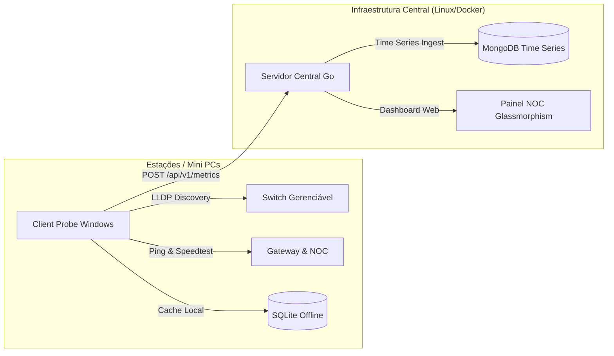

<div align="center">

# 🌐 Acon Net Tools
### Sistema Distribuído de Telemetria de Rede, Descoberta LLDP & Painel NOC Central

[](https://golang.org)
[](https://wails.io)
[](https://www.mongodb.com)
[](https://www.docker.com)
[](https://www.chartjs.org)

<p align="center">
  <b>Monitoramento contínuo de conectividade, vazão (Throughput) e latência em tempo real com mapeamento físico de switches e hardware.</b>
</p>

</div>

---

## 📌 Visão Geral

O **Acon Net Tools** é uma solução completa e distribuída para monitoramento de infraestrutura de rede, voltada para data centers, campi universitários e ambientes corporativos. O sistema opera de ponta a ponta:

1. **Sondas Distribuídas (`client-probe`)**: Instaladas em mini PCs ou estações Windows, coletam métricas de rede, especificações do computador e descobrem automaticamente a que switch, porta física e VLAN o equipamento está conectado via **LLDP**.
2. **Servidor Central Coletor (`central-server`)**: Backend em Go de alta performance com banco de dados **MongoDB Time Series**, protegendo os dados com autenticação RBAC e servindo um painel NOC moderno em tempo real com tema Glassmorphism.



---

## ⚡ Principais Recursos

### 🖥️ Sonda Desktop (`client-probe`)
- **Arquitetura Leve em Go + Wails v2:** Interface nativa e compacta com visual escuro elegante.
- **Testes Automáticos de Throughput & Latência:** Medições contínuas de Download, Upload e Ping de Gateway em intervalos configuráveis.
- **Topologia de Rede via LLDP/CDP:** Identifica automaticamente o nome do switch corporativo, modelo, porta física conectada e VLAN atribuída.
- **Inspeção de Hardware e SO:** Coleta automatizada de Hostname, Processador (CPU), Memória RAM, IP, MAC Address e Adaptador de rede ativo.
- **Resiliência *Offline-First*:** Caso o servidor central ou a conexão caiam, as medições são armazenadas no **SQLite local** (`probe_local.db`) e sincronizadas automaticamente assim que a rede restabelecer.

---

### 🏛️ Servidor Central & Dashboard NOC (`central-server`)
- **Ingestão Time Series com MongoDB:** Projetado para suportar milhões de pontos históricos organizados cronologicamente por nós e data centers.
- **Painel Web com Glassmorphism:** Dashboard futurista e responsivo com gráficos interativos em **Chart.js** (comparativos de banda e latência entre diferentes sondas).
- **Inspeção Detalhada por Clique:** Clique sobre o card de qualquer computador para abrir um modal completo com configurações de hardware, rede e switch conectado.
- **Sistema de Login e Controle de Acesso (RBAC):** Sessões seguras via cookies assinados (HMAC-SHA256) com dois níveis de permissão:
  - **Administrador:** Visualização completa, inspeção e permissão de exclusão de computadores do sistema.
  - **Operador:** Visualização de telemetria e especificações sem permissão de exclusão.
- **Volume Persistente no Docker:** Configurado para manter os dados no disco local do host (`./mongo_data`), garantindo que comandos como `docker compose down` nunca apaguem o histórico do banco.

---

## 📂 Estrutura do Repositório

```
polling-app/
├── client-probe/                     # 🖥️ Agente Desktop Windows (Wails v2 + Go)
│   ├── app.go                        # Lógica da aplicação Wails e rotina em background
│   ├── probe.go                      # Medições de Throughput e Latência (Ping)
│   ├── sysinfo.go                    # Coleta de especificações de hardware do PC
│   ├── lldp.go                       # Captura de anúncios LLDP/CDP de switches
│   ├── storage.go                    # Persistência local em SQLite e sync offline
│   ├── frontend/                     # Interface do agente desktop (HTML/CSS/JS)
│   └── README.md                     # Guia de compilação da sonda
│
└── central-server/                   # 🐧 Servidor Central Coletor (Go + Docker)
    ├── main.go                       # Entrypoint e roteador HTTP
    ├── handlers/                     # Handlers REST (Auth, Métricas, Speedtest)
    │   ├── auth.go                   # Login, logout e middlewares RBAC
    │   └── metrics.go                # Ingestão e exclusão de nós
    ├── db/mongodb.go                 # Conexão MongoDB e queries Time Series
    ├── public/                       # 🌐 Dashboard Web NOC
    │   ├── index.html                # Estrutura do painel e modais
    │   ├── style.css                 # Design system em Glassmorphism
    │   └── app.js                    # Gráficos Chart.js e interatividade
    ├── docker-compose.yml            # Orquestração com volume persistente no host
    └── README.md                     # Guia de implantação do servidor
```

---

## 🚀 Como Executar

### 1. Servidor Central (Linux / Docker)

Na pasta `central-server`, inicialize os containers do servidor Go e MongoDB:

```bash
cd central-server
docker compose up -d --build
```

Acesse o Dashboard no navegador: **`http://<IP_DO_SERVIDOR>:8085`**

#### 🔑 Credenciais Padrão de Acesso:
| Perfil | Usuário | Senha Padrão | Permissões |
|:---|:---|:---|:---|
| **Administrador** | `admin` | `admin123` | Acesso total + Exclusão definitiva de computadores |
| **Operador** | `operador` | `operador123` | Visualização de métricas e configurações de hardware |

---

### 2. Sonda Desktop (Windows)

#### Modo de Desenvolvimento:
```powershell
cd client-probe
wails dev
```

#### Compilar Executável de Produção:
```powershell
cd client-probe
wails build -clean -platform windows/amd64
```
O executável portátil será gerado em: `client-probe/build/bin/probe-app.exe`.

---

## 📑 Contrato da API (`POST /api/v1/metrics`)

Payload completo enviado pelas sondas:

```json
{
  "node_id": "minipc-dc-01",
  "location": "Guarapuava-DC1",
  "timestamp": "2026-09-18T15:00:00Z",
  "download_mbps": 850.5,
  "upload_mbps": 720.0,
  "ping_gateway": 1.2,
  "system_info": {
    "hostname": "PC-TI-01",
    "model": "OptiPlex 7090",
    "cpu": "11th Gen Intel Core i7-11700",
    "ram_total_gb": 16.0,
    "os": "windows",
    "ip_address": "192.168.1.105",
    "mac_address": "00:1A:2B:3C:4D:5E",
    "gateway": "192.168.1.1",
    "network_adapter": "Realtek PCIe GbE Family Controller"
  },
  "switch_info": {
    "switch_name": "SW-CORE-01",
    "switch_port": "GigabitEthernet1/0/12",
    "vlan": 100,
    "switch_model": "Cisco Catalyst 2960",
    "protocol": "LLDP"
  }
}
```

---

## 🛠️ Tecnologias Utilizadas

- **Linguagem Principal:** Go (Golang) 1.22+
- **Desktop Framework:** Wails v2
- **Banco de Dados:** MongoDB 7 (Time Series Engine) & SQLite
- **Frontend NOC:** Vanilla JavaScript, CSS Glassmorphism & Chart.js
- **Containerização:** Docker & Docker Compose
- **Protocolos de Rede:** LLDP, CDP, ICMP, TCP, HTTP Speedtest

---

<div align="center">
  Desenvolvido para infraestruturas de rede de alto desempenho • Licença MIT
</div>
