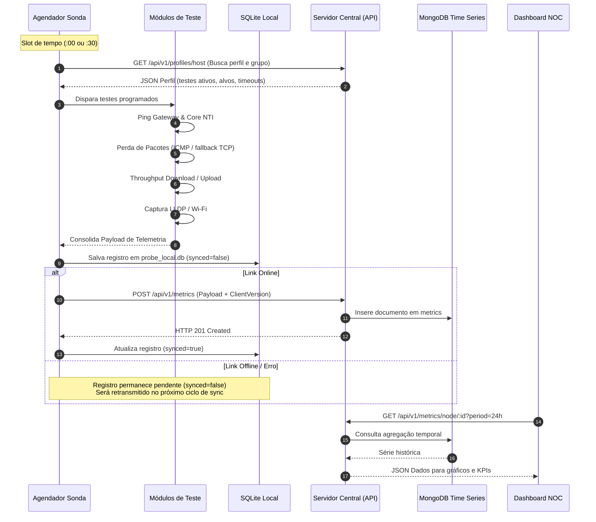

# Fluxo de Telemetria e Sincronização

Este documento detalha o ciclo de vida completo de uma medição de rede, desde o agendamento na sonda cliente até a visualização no Dashboard NOC.

---

## 1. Diagrama de Sequência do Ciclo de Telemetria



---

## 2. Estrutura do Payload de Telemetria (`MetricPayloadInput`)

Quando a sonda conclui a bateria de testes, envia uma requisição `POST /api/v1/metrics` contendo:

```json
{
  "node_id": "DESKTOP-H7U5DKH",
  "location": "Bloco L - Campus Uvaranas",
  "client_version": "2.4.1",
  "group_name": "Grupo ACON (Anel de Conectividade)",
  "metrics": {
    "download_mbps": 94.9,
    "upload_mbps": 120.8,
    "ping_gateway": 0.3,
    "ping_central": 1.2,
    "packet_loss": 0.0,
    "modular_results": {
      "ping_gateway": {
        "value": 0.3,
        "unit": "ms",
        "status": "ok",
        "details": "Alvo: 10.0.128.1 | RTT Médio: 0.3ms"
      },
      "packet_loss_gateway": {
        "value": 0.0,
        "unit": "%",
        "status": "ok",
        "details": "Alvo: 10.0.128.1 | Perda: 0.0% (10 pacotes)"
      }
    }
  },
  "system_info": {
    "hostname": "DESKTOP-H7U5DKH",
    "os": "windows",
    "arch": "amd64",
    "ip_address": "10.0.101.52",
    "mac_address": "D0-C1-B5-81-F7-61",
    "gateway": "10.0.101.1",
    "client_version": "2.4.1",
    "interfaces": [
      {
        "name": "Ethernet",
        "mac": "d0-c1-b5-81-f7-61",
        "ip": "10.0.101.52",
        "is_primary": true,
        "type": "ethernet"
      }
    ]
  },
  "switch_info": {
    "switch_name": "ACONS0001",
    "switch_port": "GE1/0/4",
    "vlan": 1101,
    "protocol": "LLDP"
  }
}
```

---

## 3. Resiliência e Buffer Offline (SQLite Local)

Se a conectividade cair durante o teste:
1. A medição é registrada imediatamente na tabela `metrics` do SQLite local com a flag `synced = 0`.
2. A sonda prossegue a operação normalmente sem travar a interface nem interromper o agendador.
3. No ciclo seguinte (ou quando o servidor voltar a responder), a função `SyncPendingMetrics()` busca todas as linhas pendentes e despacha para o servidor em lote.
4. Após o `HTTP 200/201`, o status local é marcado como `synced = 1`.

