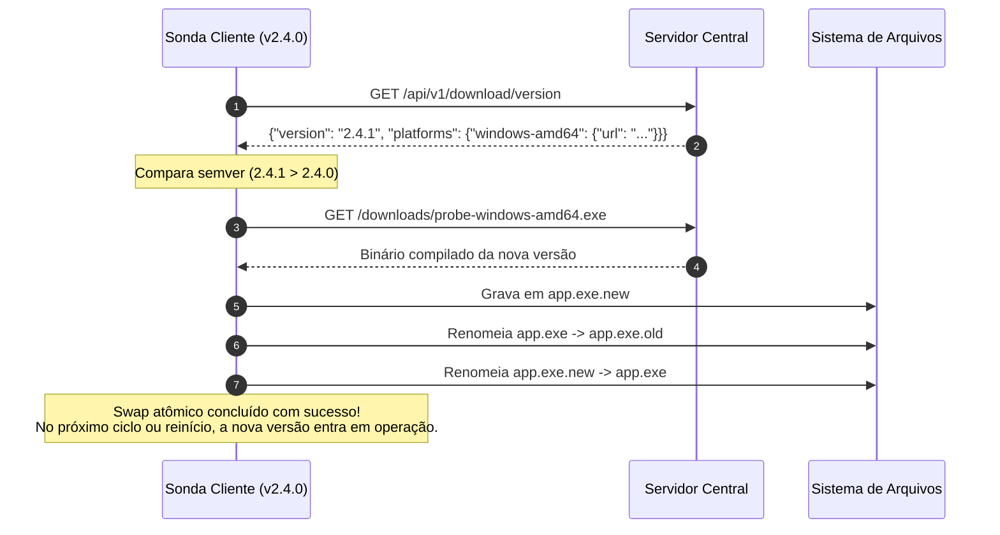

# Sistema de Auto-Update e Versionamento — Sonda Cliente

Para permitir que centenas de computadores e servidores de borda permaneçam sempre alinhados com os novos módulos e correções sem necessidade de reinstalação manual, a sonda possui um subsistema nativo de auto-patching em disco (`client-probe/updater.go`).

---

## 1. Versionamento Semântico

A versão atual do cliente é fixada na constante:
```go
const CurrentClientVersion = "2.4.1"
```

A versão é transmitida em todas as requisições de telemetria enviadas ao servidor central (`sysInfo.ClientVersion` e `payload.ClientVersion`) e salva tanto no SQLite quanto no MongoDB.

---

## 2. Fluxo de Auto-Update



---

## 3. Swap Atômico e Limpeza de Resíduos

No Windows, o sistema operacional bloqueia a sobrescrita direta de um arquivo `.exe` que esteja em execução. No entanto, o Windows **permite renomear** um executável ativo.

O mecanismo do `updater.go` explora essa característica:
1. O novo binário é baixado para `<execPath>.new`.
2. O binário atual em execução é renomeado para `<execPath>.old`.
3. O novo binário `<execPath>.new` é renomeado para `<execPath>`.
4. Quando a aplicação é reiniciada ou reinicializada pelo agendador, a função `CleanupOldBinaries()` remove com segurança o arquivo `.old` restante.

---

## 4. Verificação Manual via Interface

No aplicativo desktop Windows, o usuário pode clicar no botão **"Verificar atualizações"** no topo da janela:
- O frontend invoca o método Go `CheckUpdateNow()`.
- A sonda executa a checagem no servidor central e exibe feedback em tela informando se a versão atual já é a mais recente ou se o patch foi baixado e instalado com sucesso.

